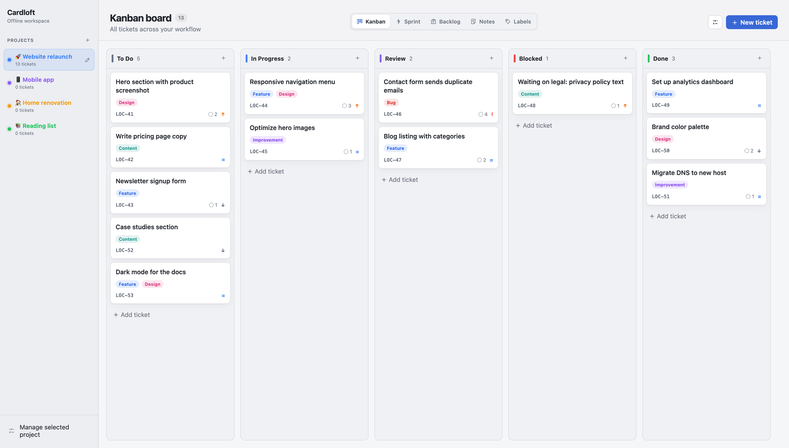

# Cardloft

A private, offline kanban board for macOS and Windows. No account, no cloud, no tracking — your projects live in a single JSON file on your own computer.

**Website:** https://nikolaops.github.io/cardloft/



## Features

- Kanban board with drag-and-drop cards
- Sprint board and a separate backlog
- Custom columns with their own order and colors
- Tickets with description, private notes, priority, labels and comments
- Multiple fully separated projects, managed from the sidebar, each with a name, color and optional emoji
- Per-project notebook with colored sticky notes
- Native confirmation dialogs before anything is deleted
- Everything stored locally

## Download

Get the latest version from the [Releases](https://github.com/nikolaops/cardloft/releases/latest) page.

### macOS 13 or newer

1. Open `Cardloft-<version>-macos.dmg` and drag **Cardloft** into **Applications**.
2. The app is not notarized by Apple, so the first launch is blocked. Open **System Settings → Privacy & Security**, scroll down and click **Open Anyway** next to the Cardloft message.

Runs natively on Apple silicon and Intel Macs.

### Windows 10 or 11

1. Unzip `Cardloft-<version>-windows.zip` to a folder of your choice, for example `C:\Users\<you>\Apps\Cardloft`.
2. Run `Cardloft.exe`. The app is not code-signed yet, so SmartScreen may warn you; click **More info → Run anyway**.

Cardloft uses the Microsoft Edge WebView2 Runtime, which is already installed on Windows 11 and up-to-date Windows 10. If it is missing, the app offers to open the download page.

## Where your data lives

| Platform | Location |
| --- | --- |
| macOS | `~/Library/Application Support/Cardloft/workspace.json` |
| Windows | `%APPDATA%\Cardloft\workspace.json` |

Back up or move that file to keep your boards. Every change is written to the file and to the web view's local storage, so a reload never loses work.

## Building from source

Both builds run on macOS with Command Line Tools installed. The Windows build also needs the [.NET SDK](https://dotnet.microsoft.com/download) (8 or newer).

```bash
node tests/state.test.js      # web UI state tests
./scripts/build-macos.sh      # build/dist/Cardloft-<version>-macos.dmg
./scripts/build-windows.sh    # build/dist/Cardloft-<version>-windows.zip
```

### Project layout

| Path | Contents |
| --- | --- |
| `web/` | The app itself: HTML, CSS and JavaScript shared by both platforms |
| `macos/` | Native AppKit + WebKit host, app icon renderer and `Info.plist` |
| `windows/` | Native WinForms + WebView2 host (.NET Framework 4.8, built into Windows) |
| `scripts/` | Build scripts |
| `tests/` | Node tests for state persistence and migration |
| `docs/` | Landing page, published with GitHub Pages |

## Releasing

1. Update `VERSION`.
2. Commit, then tag and push: `git tag v$(cat VERSION) && git push origin main --tags`.

GitHub Actions builds both apps, launches the Windows build on a Windows runner as a smoke test, and publishes a release with the DMG and the zip attached.

## License

[MIT](LICENSE)
